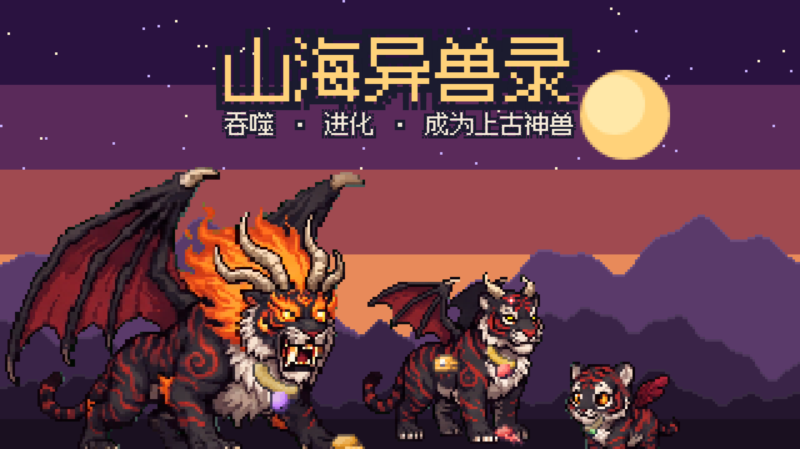

# 山海异兽录 Shanhai Beasts

放置养成：你是一只山海经里的小异兽，吞噬、进化，成为上古神兽。

**在线试玩：** https://grrreymane.github.io/IdleMaster/

## 怎么玩

- （待补充）

## 本地运行

整个游戏是一个 `index.html`，没有构建步骤，直接用浏览器打开即可（或 `python -m http.server` 后访问）。进度保存在浏览器本地存储里。

改了游戏里的文字后运行 `python D:/Minigame/_workflow/tools/subset_font.py .` 更新字体子集。
